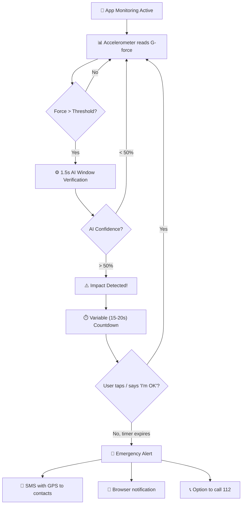

# CrashGuard — Accident Detection App Walkthrough

## What Was Built
A **Progressive Web App** that detects road accidents using the phone's accelerometer, sends emergency SMS alerts with GPS location, and shows nearest hospitals on an interactive map.

**Tech**: React + Vite, Leaflet, Overpass API, Device Motion API, Geolocation API

## App Demo


## Pages

````carousel
### 📊 Dashboard
- Power button to start/stop accelerometer monitoring
- Real-time radial gauge showing G-force
- GPS, Contacts, Threshold, Countdown status cards
- Live acceleration timeline chart
- **Desktop testing**: "Simulate Impact" button appears when monitoring is active


<!-- slide -->
### 📱 Emergency Contacts
- Add/edit/delete emergency contacts (name, phone, relationship)
- Persisted in localStorage
- These contacts receive SMS alerts on impact detection


<!-- slide -->
### ⚙️ Settings
- Sensitivity threshold slider (15–50 m/s²)
- Countdown duration (5–30 sec)
- Push notifications & vibration toggles
- Custom emergency message template
- Auto-start monitoring toggle


````

## Key Features

| Feature | How It Works |
|---------|-------------|
| **Impact Detection** | `DeviceMotionEvent` → calculates `√(x²+y²+z²)` → triggers when threshold exceeded |
| **AI Fall-Detection** | Differentiates true vehicle crashes from simple phone drops by analyzing 1.5s post-impact sensor variance. Discards false alarms and scales countdown timers based on AI confidence. |
| **Emergency Countdown** | Variable countdown (15s–20s) based on AI confidence, with "I'm OK" cancel and voice-safe-word bypass |
| **SMS Alert** | Opens native SMS with GPS coordinates pre-filled to all saved contacts |
| **Hospital Map** | Leaflet + free Overpass API (OpenStreetMap) — no API keys needed |
| **GPS Tracking** | Continuous position via `navigator.geolocation.watchPosition` |
| **Desktop Testing** | Simulated accelerometer + "Simulate Impact" button |
| **PWA** | Installable via "Add to Home Screen", works offline |

## How to Use

```bash
# Dev server (already running)
cd "c:\Users\asus\OneDrive\Desktop\accicent detection"
npm run dev
# → http://localhost:5173/

# Install on phone: open URL in Chrome → Menu → "Add to Home Screen"
```

## Accident Detection Flow



## Files Created

| Category | Files |
|----------|-------|
| **Services** | [accelerometer.js](file:///c:/Users/asus/OneDrive/Desktop/accicent%20detection/src/services/accelerometer.js), [geolocation.js](file:///c:/Users/asus/OneDrive/Desktop/accicent%20detection/src/services/geolocation.js), [emergency.js](file:///c:/Users/asus/OneDrive/Desktop/accicent%20detection/src/services/emergency.js), [hospitals.js](file:///c:/Users/asus/OneDrive/Desktop/accicent%20detection/src/services/hospitals.js) |
| **Components** | [AccelerometerGauge.jsx](file:///c:/Users/asus/OneDrive/Desktop/accicent%20detection/src/components/AccelerometerGauge.jsx), [AccelerationChart.jsx](file:///c:/Users/asus/OneDrive/Desktop/accicent%20detection/src/components/AccelerationChart.jsx), [EmergencyCountdown.jsx](file:///c:/Users/asus/OneDrive/Desktop/accicent%20detection/src/components/EmergencyCountdown.jsx), [BottomNav.jsx](file:///c:/Users/asus/OneDrive/Desktop/accicent%20detection/src/components/BottomNav.jsx), [Header.jsx](file:///c:/Users/asus/OneDrive/Desktop/accicent%20detection/src/components/Header.jsx) |
| **Pages** | [Dashboard.jsx](file:///c:/Users/asus/OneDrive/Desktop/accicent%20detection/src/pages/Dashboard.jsx), [MapView.jsx](file:///c:/Users/asus/OneDrive/Desktop/accicent%20detection/src/pages/MapView.jsx), [Contacts.jsx](file:///c:/Users/asus/OneDrive/Desktop/accicent%20detection/src/pages/Contacts.jsx), [Settings.jsx](file:///c:/Users/asus/OneDrive/Desktop/accicent%20detection/src/pages/Settings.jsx) |
| **PWA** | [manifest.json](file:///c:/Users/asus/OneDrive/Desktop/accicent%20detection/public/manifest.json), [sw.js](file:///c:/Users/asus/OneDrive/Desktop/accicent%20detection/public/sw.js), [favicon.svg](file:///c:/Users/asus/OneDrive/Desktop/accicent%20detection/public/icons/favicon.svg) |
| **Root** | [App.jsx](file:///c:/Users/asus/OneDrive/Desktop/accicent%20detection/src/App.jsx), [main.jsx](file:///c:/Users/asus/OneDrive/Desktop/accicent%20detection/src/main.jsx), [index.html](file:///c:/Users/asus/OneDrive/Desktop/accicent%20detection/index.html), [index.css](file:///c:/Users/asus/OneDrive/Desktop/accicent%20detection/src/index.css) |
